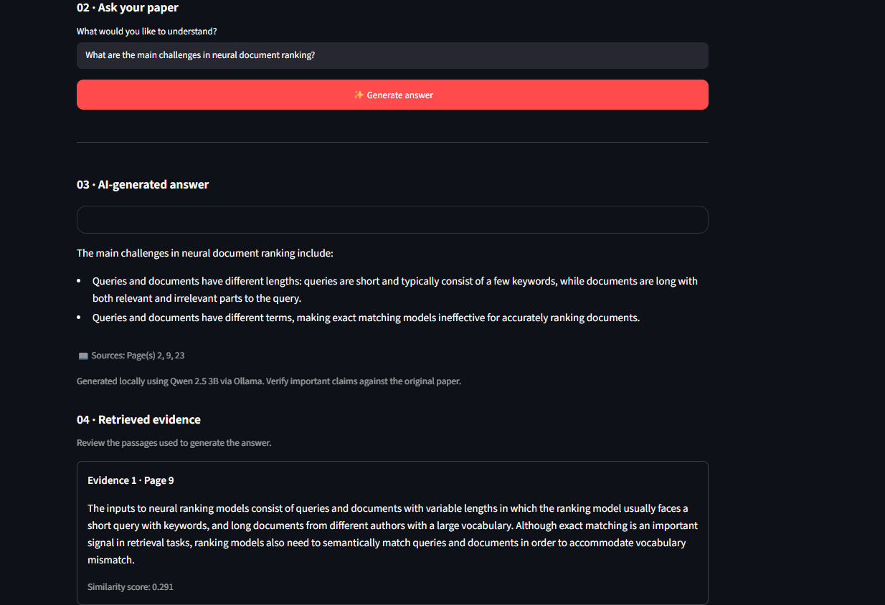

# 📚 ResearchBuddy AI

**An AI-powered research paper assistant that answers questions using evidence retrieved from PDF documents.**

ResearchBuddy AI allows users to upload a research paper, ask questions about its contents, and receive concise answers generated by a locally running language model. It retrieves relevant passages from the document and displays supporting evidence with page references.


## 📸 Demo



## ✨ Features

- **PDF upload:** Upload research papers in PDF format.
- **Text extraction:** Extract text from PDF pages using `pypdf`.
- **Evidence retrieval:** Find relevant passages using TF-IDF and cosine similarity.
- **Local AI answers:** Generate answers using Qwen 2.5 3B through Ollama.
- **Source references:** Display retrieved passages and their PDF page numbers.
- **Evidence inspection:** Review the passages used to generate an answer.
- **Local processing:** Run the application and language model on your own computer.

## 🛠️ Technology Stack

| Technology | Purpose |
|---|---|
| Python | Application logic |
| Streamlit | Web interface |
| pypdf | PDF text extraction |
| scikit-learn | TF-IDF vectorization and cosine similarity |
| Ollama | Local language model runtime |
| Qwen 2.5 3B | Answer generation |
| Requests | Communication with the Ollama API |

## ⚙️ How It Works

1. **Upload:** The user uploads a research paper in PDF format.
2. **Extract:** The application extracts text from the PDF and organizes it by page.
3. **Retrieve:** TF-IDF and cosine similarity help identify passages relevant to the user's question.
4. **Generate:** The retrieved evidence is passed to Qwen 2.5 3B through Ollama.
5. **Display:** The application presents the generated answer alongside retrieved passages and page references.

## 📋 Prerequisites

Install the following before running the project:

- Python 3.10 or later
- Ollama
- The Qwen 2.5 3B model
- Git (optional, for version control)

## 🚀 Installation and Setup

### 1. Clone the repository

Replace `YOUR_USERNAME` with your GitHub username after creating the repository.

```bash
git clone https://github.com/YOUR_USERNAME/ResearchBuddy_AI.git
cd ResearchBuddy_AI
```

Alternatively, open your existing local project folder.

### 2. Create a virtual environment

**Windows:**

```bash
python -m venv .venv
.venv\Scripts\activate
```

### 3. Install Python dependencies

```bash
pip install streamlit pypdf scikit-learn requests numpy
```

### 4. Install and start Ollama

Download Ollama from [ollama.com](https://ollama.com/).

Pull the required model:

```bash
ollama pull qwen2.5:3b
```

Make sure Ollama is running and the model is available locally.

### 5. Run the application

```bash
streamlit run app.py
```

Open the local URL displayed in the terminal, usually:

`http://localhost:8501`

## 💡 How to Use

1. Start the application.
2. Upload a research paper in PDF format.
3. Enter a question about the paper.
4. Generate an AI answer.
5. Review the retrieved evidence and page references to verify the answer.

## ⚠️ Limitations

- Answer quality depends on the relevance of the retrieved passages.
- TF-IDF primarily relies on lexical similarity and may miss relevant passages that use different terminology.
- Scanned PDFs without extractable text may not work without OCR.
- Generated answers can omit details or misinterpret evidence; verify important claims against the original paper.
- Performance depends on the available system resources and local model configuration.

## 🔮 Future Improvements

- Improve retrieval for tables, datasets, and numerical results.
- Add conversation history for follow-up questions.
- Support multiple research papers.
- Improve source citation and evidence highlighting.
- Add OCR support for scanned PDFs.
- Evaluate retrieval quality using a fixed test set of questions and expected source passages.

## 🔒 Privacy

The application uses a locally running Ollama model for answer generation. Uploaded documents and questions are processed by the application locally as configured. This does not guarantee that every environment or future integration will remain local; users should verify their own setup.

## 👨‍💻 Author

Developed as an academic project exploring document retrieval, natural language processing, and locally hosted language models.

---

*ResearchBuddy AI — Ask questions. Find evidence. Understand research.*